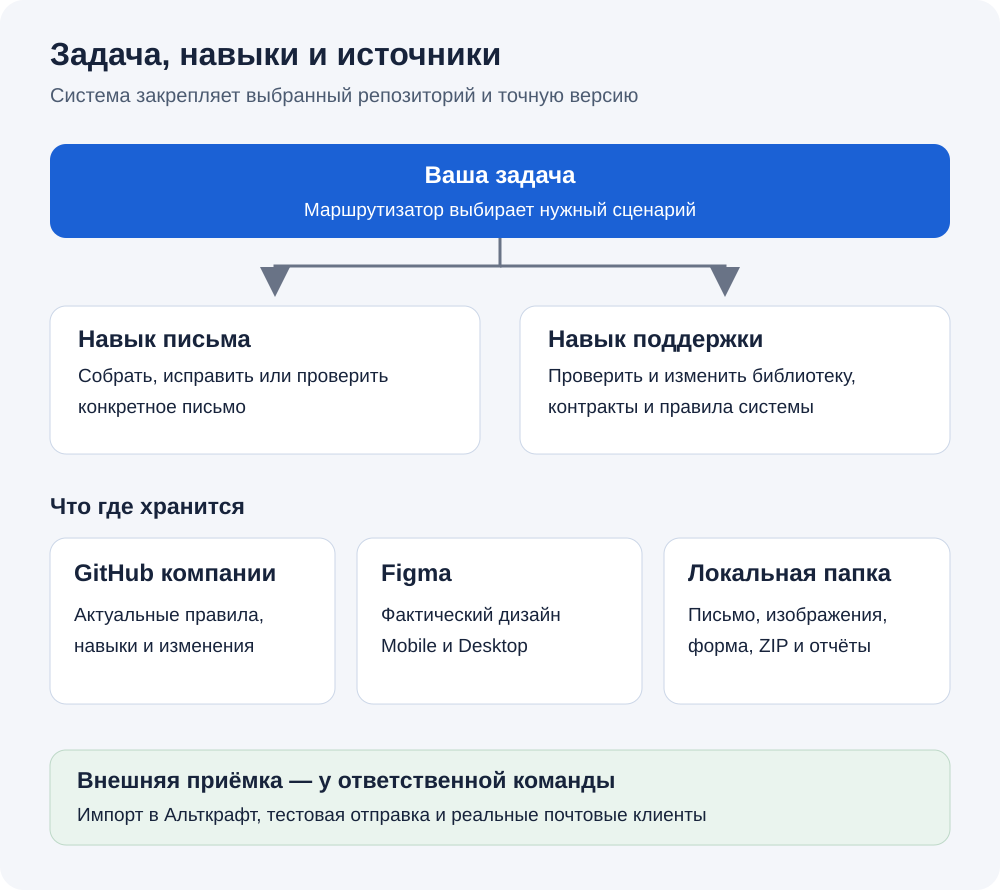
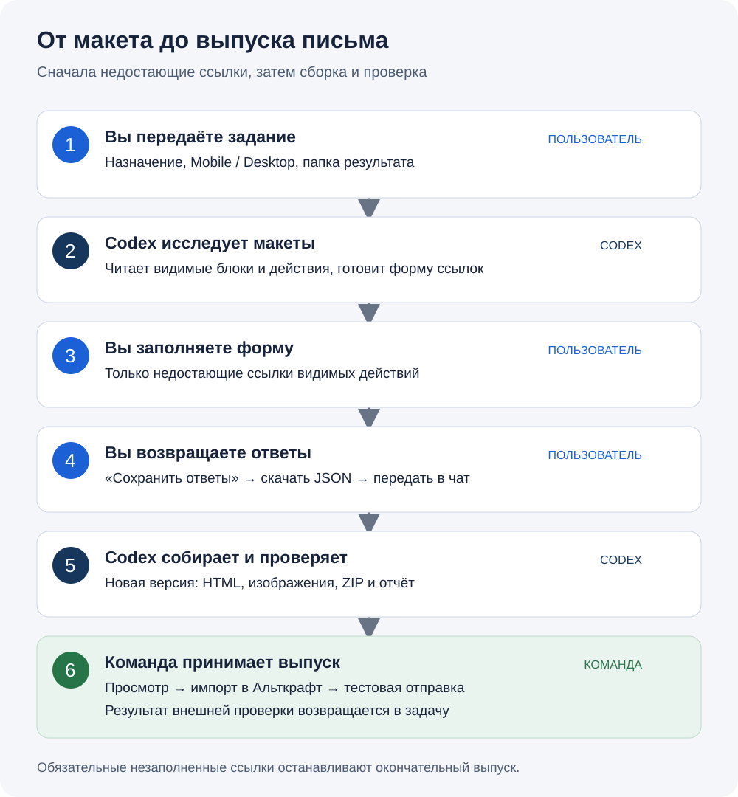

# Как работать с email-системой ЕДИНЫЙ ЦУПИС

Эта инструкция рассчитана на сотрудника, который впервые открывает проект. Для обычной работы не нужно редактировать код или выбирать модель вручную: вы передаёте задачу и материалы Codex, заполняете параметры письма и проверяете результат.

Система собирает маркетинговые и сервисные письма по конкретным макетам Figma, выпускает HTML с изображениями и архив для Альткрафта. Она также помогает проверять и поддерживать действующую библиотеку компонентов.

Актуальные правила берутся из основной ветки репозитория компании в GitHub. Figma задаёт дизайн. Готовые письма, ваши ответы, изображения и отчёты хранятся в отдельных локальных папках. Адрес репозитория не привязан к имени сотрудника.

## Содержание

- [Что подготовить](#prepare)
- [Первый запуск](#first-start)
- [Как поставить задачу](#request)
- [Собрать новое письмо: от макета до архива](#build)
- [Заполнить форму](#form)
- [Проверить и передать результат](#result)
- [Исправить готовое письмо](#fix)
- [Работать с библиотекой](#library)
- [Продолжить в новом чате или на другом ПК](#resume)
- [Если работа остановилась](#help)
- [Термины и технические источники](#terms)

<a id="prepare"></a>
## 1. Что подготовить

Получите у ответственного за систему:

| Что нужно | Для чего |
| --- | --- |
| Каноническая ссылка на GitHub-репозиторий компании и доступ к нему | Чтобы Codex читал актуальные правила; для изменения системы нужен доступ на запись |
| Доступ к файлу Figma и ссылки на конкретные Mobile и Desktop макеты письма | Чтобы определить блоки, текст, изображения и различия версий |
| Задача, назначение письма и папка для результата | Чтобы правильно выбрать сценарий и создать отдельную версию |
| Тема, прехедер и адреса переходов | Чтобы подготовить выпуск; недостающие значения можно заполнить после исследования |
| Доступ к Альткрафту у сотрудника, который будет загружать письмо | Для внешней проверки импорта и отправки |

Ссылки на макеты должны вести к нужным экземплярам письма, а не только к главной странице файла. Подпишите, где Mobile, а где Desktop. При исправлении только технической ошибки без изменения дизайна новые ссылки Figma могут не понадобиться.

Выберите постоянную папку для результатов, например `Письма ЦУПИС`. Она должна находиться вне локального слепка репозитория. Не складывайте выпуск, форму или изображения в папки с системными правилами.

Если вам передали только ZIP репозитория, запросите также каноническую ссылку GitHub. Архив помогает познакомиться с файлами, но сам по себе не подтверждает актуальность системы и адрес публикации правок.

<a id="first-start"></a>
## 2. Первый запуск на вашем ПК

1. Откройте приложение с Codex и войдите в свой рабочий аккаунт. Базовый порядок установки, входа и выбора проекта описан в [официальной инструкции OpenAI](https://learn.chatgpt.com/docs/quickstart).
2. Выберите проект или рабочую папку. Для этой системы GitHub остаётся источником правил; локальные папки используются для результатов и проверки закреплённой версии.
3. Начните чат в Codex. Вставьте реальную ссылку компании вместо строки в квадратных скобках и отправьте:

   ```text
   Открой репозиторий [ссылка GitHub компании] и восстанови рабочую среду проекта.
   Результаты писем сохраняй в [путь моей папки].
   ```

4. Codex проверит доступ к GitHub и Figma, необходимые навыки, инструменты и зависимости. Если требуется вход в GitHub или Figma, выполните его штатным способом. Пароли и токены в чат вставлять не нужно.
5. Если обнаружены разные установленные копии навыка, Codex должен назвать конфликт и показать, какую копию предлагается обновить. Замена существующих пользовательских навыков и изменение глобальных настроек согласуются отдельно; уже данное разрешение повторять не нужно.
6. Дождитесь отчёта восстановления. В нём должны быть фактическое обнаружение навыков, их версия, состояние подключений и локальные проверки. Сообщения «файлы скопированы» недостаточно для подтверждения полноценной установки.

**Сначала подготовьте среду, затем поручайте сборку.** Если необходимое подключение или обнаружение навыка не подтверждено, устраните указанную причину по отчёту.

При первой настройке с разрешёнными локальными путями сохраняется профиль вашей пары «пользователь + ПК». Он помогает выбрать среду проверок и ограничения нагрузки. Перед каждым тестом диагностика не повторяется; в новом чате используется сохранённая привязка. Профиль не публикуется в GitHub. Его сведения не являются измерением текущей нагрузки ПК.

Чтобы только прочитать состояние системы, без установки и настройки, используйте другую команду:

```text
Открой репозиторий [ссылка GitHub компании] и ознакомься с проектом.
Скажи, что доступно и какие подключения нужны для моей задачи.
```

Подробный протокол восстановления, включая разрешения и проверки установки: [bootstrap](../bootstrap/README.md).

<a id="request"></a>
## 3. Как выбрать задачу и навык

Опишите желаемый результат обычными словами. Маршрутизатор определит, нужен навык сборки письма или поддержки системы. Если просьба объединяет письмо и изменение библиотеки, это будут две области работы со своими зависимостями.



| Задача | Пример запроса |
| --- | --- |
| Собрать новое письмо | «Сверстай сервисное письмо по Mobile и Desktop макетам. Подготовь выпуск для Альткрафта» |
| Исправить конкретный выпуск | «В этой версии письма неверная ссылка на кнопке. Исправь её и создай следующую версию» |
| Проверить готовое письмо | «Проверь эту папку письма по этим макетам. Нужен отчёт без изменения файлов» |
| Проверить библиотеку | «Проверь соответствие этих компонентов Figma и контрактов. Сначала нужен отчёт» |
| Обновить систему | «Внеси такое изменение в правила системы; область изменения — …» |
| Узнать состояние | «Ознакомься с проектом и скажи, что сейчас доступно и что делать дальше» |

Навыки задают порядок работы, а структурированные данные — точные правила. Исполнитель выбирается по сложности задачи и доступности нужной модели, с предусмотренным запасом качества. Независимая содержательная проверка оценивает соответствие исходной задаче; успешные тесты сами по себе её не заменяют.

Не требуется перед каждой задачей искать «самую новую GPT». Если предусмотренная модель недоступна, система должна обработать именно эту недоступность и выбрать допустимый вариант по своей политике. Ошибка подключения не доказывает отсутствие модели.

<a id="build"></a>
## 4. Новое письмо: последовательность действий



### Шаг 1. Передайте задание

Пример, который можно заполнить и отправить:

```text
Собери [маркетинговое / сервисное] письмо для [назначение].
Репозиторий системы: [ссылка GitHub компании].
Mobile: [ссылка на экземпляр в Figma].
Desktop: [ссылка на экземпляр в Figma].
Папка для результата: [путь вне репозитория].
Нужен выпуск для Альткрафта.
Сначала исследуй оба макета и запроси только недостающие ссылки.
```

Если ссылки на макеты не приложены, Codex покажет два отдельных поля: «Ссылка на Desktop-макет в Figma» и «Ссылка на Mobile-макет в Figma». Уже известную ссылку повторять не нужно. Все тексты берутся из письма; отдельно заполнять тему, прехедер или подписи картинок навык не просит.

### Шаг 2. Дождитесь исследования

Codex закрепляет версию системы, читает оба макета, определяет компоненты и видимые действия, которым нужен адрес. Скрытые шаги, карточки и другие части пропускаются в той версии, где они скрыты; скрытые родители отключают всё поддерево. Повторённый блок различим по его тексту и действию. Контракт описывает доступную структуру блока, а конкретный макет определяет, какие её части участвуют в этом письме.

Если компонент не зарегистрирован или его идентичность неоднозначна, сборка останавливается на этом месте. Система не заменяет его похожим блоком и не придумывает недостающие факты. Готовый компонент сначала регистрируется в отдельной задаче поддержки; проектирование нового блока в возможности этих навыков не входит.

### Шаг 3. Заполните форму

Если есть недостающие ссылки, Codex выдаст локальную ссылку на `form.html`. Откройте её в браузере, вставьте адреса и сохраните ответы. Полный порядок — [в следующем разделе](#form). Если все обязательные ссылки уже известны, этот шаг и возврат ответов пропускаются.

### Шаг 4. Верните файл ответов

После кнопки «Сохранить ответы» браузер скачает `delivery.json`. Передайте Codex этот файл или его точный путь и напишите:

```text
Ответы для этого письма сохранены в [путь delivery.json].
Продолжи сборку и подготовь выпуск для Альткрафта.
```

Форма сохраняет локальный файл; она не отправляет ответы в Альткрафт. Само заполнение полей без сохранения и передачи файла не завершает этот шаг.

Если за это время изменились макет, состав кнопок, профиль выпуска или закреплённая версия системы, может потребоваться новая форма. Старые ответы нельзя автоматически считать подходящими к новому письму.

### Шаг 5. Дождитесь сборки и проверок

После проверки обязательных значений Codex экспортирует изображения, собирает HTML и архив, выполняет предусмотренные локальные проверки и сверку с макетом. Результат сохраняется в новой версионной папке. Уже существующий выпуск не должен перезаписываться.

Если проверка не проходит, результат исправляется в своей области либо выдаётся конкретная причина остановки. Остановленный маршрут не обходится другим навыком.

### Шаг 6. Проверьте выпуск и передайте его в Альткрафт

Откройте файлы превью, прочитайте итоговый отчёт и проверьте адреса. Передайте ответственному за импорт `altcraft.zip`, отчёт и заполненные параметры. Состав файлов и граница внешней проверки описаны [ниже](#result).

<a id="form"></a>
## 5. Что заполнять в форме

В форме заполняются **только недостающие ссылки**. Каждое поле показывает блок и фактический текст кнопки или ссылки, например «Блок карточек — Пополнить счёт». У повторяющихся карточек указывается их существующий текст, чтобы различать действия.

1. Вставьте конечные согласованные адреса, включая нужные метки кампании. Разные кнопки могут вести на разные страницы.
2. Уже заданные ссылки сохраняются без повторного вопроса. Стандартные ссылки логотипа, магазинов приложений и отписки задаёт профиль доставки; отдельно заполнять их не нужно.
3. Если в письме видны ссылки `1cupis.ru` или службы поддержки в футере, предоставьте недостающие адреса. Для блока NPS нужны ссылки всех видимых вариантов ответа. Скрытым действиям ссылки не требуются.
4. Нажмите «Сохранить ответы», найдите скачанный `delivery.json` и передайте его в тот же чат. Если браузер назвал повторную загрузку `delivery (1).json`, укажите именно этот файл.

Пустая обязательная ссылка блокирует окончательный выпуск. Изменение видимости или состава действий делает старую форму непригодной; Codex проверяет это перед применением ответов.

Тексты, известные подписи изображений и уже заданные настройки сохраняются из источника. Для изображения используется подходящий существующий текст; декоративному изображению оставляется пустая подпись. Вопросов о модели, alt-текстах, теме, прехедере и отправителе в форме нет. Если тема или другие параметры рассылки отсутствуют в источнике, навык их не сочиняет: вёрстка и ZIP доступны, а незаданные параметры настраиваются ответственным за отправку в Альткрафте. `subject.txt` в таком выпуске может быть пустым.

Модель задаётся вашим выбором в Codex. Навык подбирает только поддерживаемое усилие, с одним дополнительным шагом запаса качества, и сохраняет эту модель у исполнителей и независимых проверяющих.

<a id="result"></a>
## 6. Какие файлы вы получите

Для выпуска с профилем Альткрафта:

| Файл или папка | Как использовать |
| --- | --- |
| `email.html` | HTML выпуска; обычное открытие в браузере показывает только браузерное отображение |
| `images/` | Изображения письма; храните вместе с HTML и сохраняйте их имена |
| `preview-name.html` | Превью приветствия с обычным именем |
| `preview-empty-name.html` | Превью приветствия без имени |
| `preview-long-name.html` | Превью с длинным именем для проверки переносов |
| `altcraft.zip` | Архив для передачи в Альткрафт с HTML, изображениями и служебными файлами |
| `release-report.json` | Данные выпуска: версия системы, выполненные проверки, готовность ссылок и область внешней приёмки |

Исходная форма и возвращённый `delivery.json` находятся в папке подготовки параметров. Сохраните их вместе с материалами задачи: они помогают объяснить, откуда взялись значения.

Внутри `altcraft.zip` предусмотрены `email/html.html`, `email/subject.txt`, `email/text.txt`, служебные признаки `is_amp.txt` и `is_not_inline.txt`, а также `images/`. При явно заданных отправителе или адресе ответов добавляются соответствующие `from_*` и `replyto_*` текстовые файлы. При наследовании настроек Альткрафта эти файлы не создаются.

Для сборки только дизайнерского HTML без выпуска Альткрафта состав результата другой. Если нужен именно архив для импорта, назовите это в задании.

### Как принять результат

1. Проверьте текст и порядок блоков по обоим макетам.
2. Просмотрите обычное имя, отсутствие имени и длинное имя в файлах превью. Шаблонные выражения Альткрафта в финальном HTML не обязаны вычисляться обычным браузером.
3. Проверьте все переходы и сохранённые параметры. Не выполняйте действие отписки на реальном клиенте ради проверки ссылки.
4. Прочитайте итоговое сообщение Codex: какую версию системы использовали, что проверили и какие ограничения остались.
5. Ответственный сотрудник загружает архив в Альткрафт, проверяет изображения, тему, прехедер, отправителя и ссылки, затем выполняет принятую в компании тестовую отправку и проверку в почтовых клиентах.

Успешная локальная сборка подтверждает свою область проверки. Она не доказывает успешный импорт, отправку и отображение во всех почтовых клиентах. До внешнего результата отчёт сохраняет `external_acceptance: not-run`. Передайте замечания внешней команды вместе с конкретным выпуском.

Не изменяйте названия изображений, внутреннюю структуру ZIP или HTML вручную после проверки. Если нужны изменения, создайте следующую версию через Codex.

<a id="fix"></a>
## 7. Исправление готового письма

1. Укажите точную папку или архив версии, которую нужно исправить.
2. Опишите проблему, ожидаемый результат и где это обнаружено. Для клиентского дефекта добавьте название почтовика, тип устройства и доступные изображения проблемы.
3. Если меняется дизайн, приложите актуальные Mobile и Desktop макеты. Для замены URL или другой технической правки без изменения дизайна объясните эту границу.
4. Попросите новую версию в папке результатов и дождитесь отчёта проверок. Изменение макета или действий может потребовать обновлённой формы.

```text
Исправь письмо из [точный путь версии].
Проблема: [что происходит и где].
Нужно: [ожидаемый результат].
Область изменения: [например, только адрес кнопки «Открыть приложение»].
Новый адрес: [URL].
Сохрани следующую версию в [папка результатов] и подготовь выпуск для Альткрафта.
```

Для проверки без изменений прямо напишите: «Нужен только отчёт, файлы не менять».

<a id="library"></a>
## 8. Работа с библиотекой и системой

Навык поддержки проверяет контракты, описания, названия, источники и их согласованность. Он не выпускает конкретное письмо и не проектирует новый компонент.

1. Назовите конкретные компоненты или файлы системы и желаемое изменение.
2. Для работы с Figma приложите ссылки на нужные узлы.
3. Сначала оцените отчёт о влиянии: какие факты и зависимые материалы будут затронуты.
4. Если требуется запись в Figma, разрешение должно относиться к конкретным объектам и свойствам. Проверка макета сама по себе такой записи не разрешает.
5. Постоянные изменения системы публикуются отдельной веткой и PR в выбранном GitHub-репозитории. PR — предложение изменения для просмотра. После локальных проверок и независимого ревью слияние выполняется при соответствующем разрешении.
6. Если изменились навыки, их пользовательские копии обновляются отдельно с учётом уже данного разрешения; слияние кода не подтверждает автоматическое обновление среды всех сотрудников.

Готовый компонент можно зарегистрировать после проверки его источников. Если необходим новый дизайн, сначала организуйте его создание и согласование вне этих навыков.

<a id="resume"></a>
## 9. Новый чат, новый сотрудник или другой ПК

**Новый чат на том же ПК:** назовите репозиторий, попросите ознакомиться с проектом и передайте папку текущего выпуска, актуальные макеты, выбранный файл ответов и оставшуюся задачу. История прежнего чата не восстанавливается из репозитория автоматически.

```text
Открой репозиторий [ссылка GitHub компании] и ознакомься с проектом.
Продолжаем письмо из [папка версии].
Макеты: Mobile [ссылка], Desktop [ссылка].
Актуальные ответы: [путь delivery.json].
Осталось: [конкретное действие].
```

**Другой ПК или новый сотрудник:** выполните [первый запуск](#first-start) под своим аккаунтом. Нужны собственные доступы, обнаружение навыков и привязка пользователя к этому ПК. Копирование общей папки или OneDrive не переносит подтверждённую активную привязку.

**После обновления системы:** ознакомьтесь с текущей версией; если изменились необходимые навыки или зависимости, попросите восстановление среды. Для продолжения письма Codex проверит совместимость старых ответов с текущим источником.

Перепроверять мощность ПК перед каждым тестом не требуется. Если вы хотите переоценить сохранённый профиль после изменения оборудования или условий, прямо попросите: «Обнови сохранённый профиль этого ПК».

<a id="help"></a>
## 10. Если работа остановилась

| Сообщение или ситуация | Что сделать |
| --- | --- |
| Не определён репозиторий или указаны разные источники | Передайте одну каноническую ссылку компании и уточните, какую задачу продолжать |
| Нет доступа к GitHub/Figma | Выполните штатное подключение своего аккаунта и повторите проверку чтения |
| Навык не обнаружен или найдены конфликтующие копии | Попросите восстановление среды; согласуйте точную копию, если нужна её замена |
| Неизвестный компонент | Передайте идентичность готового компонента ответственному за регистрацию; не просите заменить его похожим |
| Обязательная ссылка не заполнена | Откройте актуальную форму, сохраните ответы и передайте выбранный JSON |
| Ответы устарели | Получите новую форму для текущего макета и версии; перенесите согласованные значения с проверкой |
| Нужная модель недоступна | Пусть Codex обработает отказ по действующей политике; произвольная замена без проверки не подтверждает качество |
| Профиль ПК отсутствует или не совпадает | Восстановите среду для текущей пары; не копируйте ключ из чужого профиля |
| Маршрут остановлен | Уточните названный блокер у ответственного за систему; другой сценарий не отменяет остановку |
| Внешний дефект в Альткрафте/почтовике | Передайте конкретный архив, клиент, устройство и описание; локальное браузерное превью этой проверки не заменяет |

В текущем процессе тесты и регрессии выполняются локально с ограничением нагрузки. GitHub используется для исходников и PR. Если выбранная среда не позволяет провести необходимые локальные проверки, Codex должен сообщить ограничение; отсутствие результата не является успешной приёмкой. Отдельный облачный сценарий не запускается автоматически и требует явного запроса и готовности среды.

<a id="terms"></a>
## 11. Термины и где читать дальше

| Термин | Понятное значение |
| --- | --- |
| Навык | Инструкция, которая учит Codex выполнять повторяющийся сценарий |
| Маршрутизатор | Выбирает сценарий по вашей задаче |
| Контракт компонента | Структурированное описание фактов и правил блока |
| Manifest | Карта системных файлов, маршрутов и навыков |
| SHA / закреплённый коммит | Точная версия файлов GitHub, на которой выполняется задача |
| Локальный слепок | Копия этой версии для чтения и проверок |
| PR | Предложение изменить систему, доступное для просмотра до слияния |
| Прехедер | Дополнительный текст рядом с темой в списке писем |

Эта инструкция объясняет работу пользователя. Точные правила и значения остаются в своих системных источниках; их не нужно вручную копировать из руководства.

- [README — карта проекта](../README.md)
- [Восстановление среды и установка навыков](../bootstrap/README.md)
- [Доступные возможности и дальнейшая работа](system-status.md)
- [Реестр компонентов для чтения](generated/component-registry.md)
- [Профили выпуска и стандартные ссылки](../data/delivery/profiles.yaml)
- [Официальное описание навыков OpenAI](https://learn.chatgpt.com/docs/build-skills)
